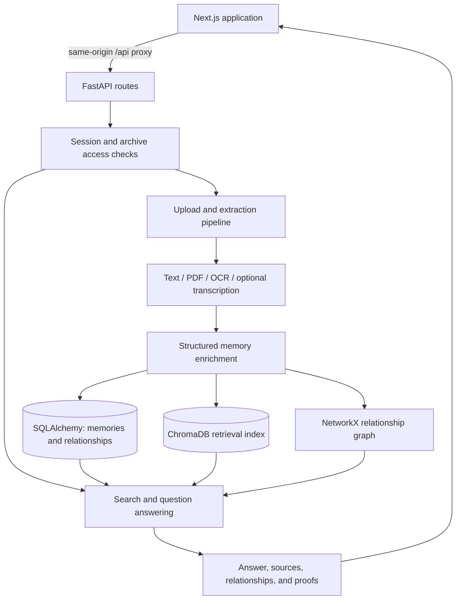

# MemoryGraph AI

**Turn scattered family memories into a searchable, connected story.**

MemoryGraph AI is a full-stack family-memory application for organizing photos, letters, documents, audio recordings, and written notes. It extracts available text, identifies people, places, dates, and events, and connects those details to a memory archive that users can search, visualize, and ask questions about.

Instead of keeping memories in disconnected folders, a family can explore who appears in a memory, when something happened, and which saved sources support an answer. The project brings together document processing, retrieval, relationship graphs, timelines, and storytelling in one Next.js and FastAPI application.

**Project status:** a hackathon prototype with an implemented frontend, backend, local demo mode, and optional external integrations. It is a development project, not a claim of production readiness or measured performance.

## What can you do with it?

| Capability | What it does |
| --- | --- |
| **Capture memories** | Upload text, Markdown, CSV, PDFs, images, and supported audio/video files. Processing stages and errors are recorded for each memory. |
| **Extract useful context** | Read text files and text-based PDFs, extract image text when Tesseract is installed, and optionally transcribe audio through OpenAI. |
| **Connect the archive** | Extract people, places, dates, and events; store relationships; explore a D3-powered family graph. |
| **Ask with sources** | Search saved memories and ask natural-language questions. Responses include matching memory records, relationship context, and source-proof data for inspection. |
| **Explore a timeline** | Browse memories by time and use the Time Machine workflow to build a narrative around an era or a person's age range. |
| **Create and share stories** | Build storybooks and life-story views, create share links, and export archive content through the implemented sharing and export routes. |
| **Work with family archives** | Register and sign in, manage sessions, invite contributors, and access an owner's archive through permission checks. |
| **Manage the collection** | Review processing status, archive and restore memories, inspect usage, and manage account data. |

Some capabilities require additional configuration. In particular, image OCR needs a local Tesseract installation, audio transcription needs an OpenAI API key, and email delivery needs SMTP credentials. See [AI modes and optional integrations](#ai-modes-and-optional-integrations).

## Example journey

1. Create an account and load the sample archive from the Studio, or upload a small `.txt` memory of your own.
2. Open the family graph to explore connections between saved people, places, events, and memories.
3. Ask a question such as **"What memories involve grandfather?"** and inspect the returned sources.
4. Use Stories or Time Machine to explore a period of a person's life. Age-based queries also need a birth year; the included sample-family example uses **1978** for the father.
5. Build a story, review it, and choose whether to create a share link.

A simple first upload could contain: `Grandfather and I visited Mumbai during summer vacation in 2015.`

## Tech stack

| Layer | Technologies and role |
| --- | --- |
| Frontend | **Next.js 16.2.6, React 19.2.4, TypeScript, Tailwind CSS 4** for the application UI; **TanStack Query** for server state; **D3.js** for relationship visualization. |
| Backend | **Python, FastAPI, Pydantic, Uvicorn** for validated REST endpoints and application services. |
| Data | **SQLAlchemy** models, **SQLite** for local development, **PostgreSQL** support, and **Alembic** migration files. |
| Retrieval and relationships | **ChromaDB** for the retrieval index and **NetworkX** for graph processing, alongside persisted SQL memory and relationship records. |
| Extraction and AI | **PyPDF2, Pillow, pytesseract**, optional **Ollama** generation/embeddings, and optional **OpenAI** audio transcription. |
| Validation | A **pytest** API-flow test, **Playwright** journey specifications, and GitHub Actions configuration for the backend test and frontend build. |

## How it works



The processing pipeline records stages such as metadata extraction, content extraction, enrichment, relationship processing, and indexing. Chat searches the user's saved memories, gathers matching relationship context, and returns both an answer and the supporting records. SQL data is the persistent application record; files and retrieval data also need their own persistent storage.

The engineering focus is connecting a typed frontend to a service-based API, keeping memory retrieval scoped to the relevant user/archive, making processing failures visible, and retaining a path from generated answers back to source memories. Source links help users inspect an answer; they do not guarantee that every generated statement is correct.

## Run locally

### Prerequisites

- **Python 3.11** is the version used by the backend CI and Dockerfile. The older dependency pins have not been validated here against Python 3.14.
- **Node.js 20.9 or newer** and npm for the frontend.
- Two terminals: one for FastAPI and one for Next.js.
- No paid AI credentials are required for the basic text/sample-archive demo.

### 1. Clone the repository

```bash
git clone https://github.com/harshgavandit/OpenAI_Project-.git
cd OpenAI_Project-
```

### 2. Start the backend

From the repository root, create a virtual environment and install the backend dependencies.

**Windows PowerShell:**

```powershell
cd MemoryGraph/backend
py -3.11 -m venv .venv
.\.venv\Scripts\python.exe -m pip install -r requirements.txt
```

**macOS / Linux:**

```bash
cd MemoryGraph/backend
python3.11 -m venv .venv
.venv/bin/python -m pip install -r requirements.txt
```

Create a file named `.env` inside `MemoryGraph/backend` with:

```dotenv
LLM_PROVIDER=fallback
DATABASE_URL=sqlite:///./data/memorygraph.db
CHROMA_DB_PATH=./data/chromadb
FRONTEND_URL=http://localhost:3000
COOKIE_SECURE=false
```

Create the database directory and start FastAPI **from the backend directory**:

```powershell
# Windows PowerShell
New-Item -ItemType Directory -Force data | Out-Null
.\.venv\Scripts\python.exe -m uvicorn app.main:app --host 127.0.0.1 --port 8000 --reload
```

```bash
# macOS / Linux
mkdir -p data
.venv/bin/python -m uvicorn app.main:app --host 127.0.0.1 --port 8000 --reload
```

The application initializes local database tables during startup; no `app.init_db` command or missing `.env.example` file is required.

- API health: <http://127.0.0.1:8000/health>
- Interactive API documentation: <http://127.0.0.1:8000/docs>

In fallback mode, `/health` can report `"reachable": false` for AI while the service itself reports `"status": "ok"`. No Ollama server is needed in this mode.

### 3. Start the frontend

In a second terminal, from the repository root:

```bash
cd MemoryGraph/frontend
npm ci
```

Create `MemoryGraph/frontend/.env.local`:

```dotenv
BACKEND_URL=http://127.0.0.1:8000
NEXT_PUBLIC_API_URL=/api
NEXT_PUBLIC_SITE_URL=http://localhost:3000
```

Then run:

```bash
npm run dev
```

Open **<http://localhost:3000>**. Next.js rewrites `/api/*` requests to the backend, so browser API calls use the same frontend origin. Keep `BACKEND_URL` as a server-side setting; do not put secrets in `NEXT_PUBLIC_*` variables.

## AI modes and optional integrations

| Mode or integration | Configuration | Actual behavior |
| --- | --- | --- |
| **Fallback demo** | `LLM_PROVIDER=fallback` | Rules-based extraction, template answers, and deterministic hashed embeddings. This is the default and is not an LLM-based semantic-understanding mode. |
| **Local Ollama** | `LLM_PROVIDER=ollama`, `OLLAMA_BASE_URL`, `OLLAMA_CHAT_MODEL`, `OLLAMA_EMBED_MODEL` | Uses the configured Ollama server for enrichment, answer generation, and embeddings. Provider failures fall back to the built-in behavior. |
| **Audio transcription** | `OPENAI_API_KEY`, optionally `OPENAI_TRANSCRIPTION_MODEL` | Sends supported audio to OpenAI transcription. The default transcription model in the code is `whisper-1`. This setting does not switch chat generation to OpenAI. |
| **Image OCR** | Install the Tesseract executable and make it available on the backend host's PATH. | Extracts text from supported image files through `pytesseract`. Installing the Python package alone is insufficient. |
| **Email and Google sign-in** | Backend `GMAIL_EMAIL` / `GMAIL_APP_PASSWORD`; Google client configuration including frontend `NEXT_PUBLIC_GOOGLE_CLIENT_ID`. | Enables the corresponding optional integration after its full configuration. |
| **Billing** | `STRIPE_SECRET_KEY` and `STRIPE_PRICE_FAMILY` | Checkout/portal integration exists, but is not configured or a completed subscription lifecycle merely by running the demo. |

For Ollama, install the models named in your configuration on the Ollama host. Current defaults are `mistral:latest` for chat and `nomic-embed-text:latest` for embeddings. Use a fresh development index when changing embedding models or dimensions; existing vectors are not automatically migrated.

Text and sample-archive workflows can run locally without cloud AI. This does **not** make every feature offline: configured transcription, email, Google sign-in, billing, and remote services use their respective networks. Review generated summaries, dates, relationships, and narratives against the original material.

## Repository guide

| Location | Purpose |
| --- | --- |
| [`MemoryGraph/frontend/app`](MemoryGraph/frontend/app) | Next.js pages, components, authentication context, graph views, and API helpers. |
| [`MemoryGraph/backend/app/main.py`](MemoryGraph/backend/app/main.py) | FastAPI application, middleware, and route registration. |
| [`MemoryGraph/backend/app/api`](MemoryGraph/backend/app/api) | Authentication, upload, search, chat, timeline, stories, sharing, and platform endpoints. |
| [`MemoryGraph/backend/app/services`](MemoryGraph/backend/app/services) | Extraction, enrichment, retrieval, AI-provider selection, access checks, storage, and export logic. |
| [`MemoryGraph/backend/app/models`](MemoryGraph/backend/app/models) | SQLAlchemy database models and Pydantic request/response schemas. |
| [`MemoryGraph/backend/alembic`](MemoryGraph/backend/alembic) | Database migration history. |
| [`MemoryGraph/backend/tests/test_saas_flow.py`](MemoryGraph/backend/tests/test_saas_flow.py) | Automated API journey covering authentication, upload, retrieval, source proofs, isolation, and timeline queries. |
| [`MemoryGraph/frontend/e2e`](MemoryGraph/frontend/e2e) | Playwright journey specifications. |
| [`.github/workflows/ci.yml`](.github/workflows/ci.yml) | Backend test and frontend build workflow. |

The root `run_agents.py` and `MemoryGraph/run_agents.py` are separate agent demonstrations, not the commands for launching the web application.

## Validation commands

From `MemoryGraph/backend`, using the virtual environment created above:

```powershell
# Windows PowerShell
.\.venv\Scripts\python.exe -m pytest tests/test_saas_flow.py -q
```

```bash
# macOS / Linux
.venv/bin/python -m pytest tests/test_saas_flow.py -q
```

The test uses its own SQLite database, fallback AI mode, and synthetic text. It does not validate live Ollama, OpenAI, SMTP, Google, or Stripe integrations.

From `MemoryGraph/frontend`:

```bash
npm run lint
npm run build
```

Playwright specifications also exist (`npm run test:e2e`). They require the API and frontend to be running and the Playwright Chromium browser to be installed; the configuration does not start the servers automatically.

The existing CI workflow is filtered to changes under `MemoryGraph/**`. A root-README-only commit does not, by itself, run that workflow. These are validation instructions and test coverage descriptions, not a claim that every check or live integration has passed on this revision.

## Storage, privacy, and deployment notes

- Account data is scoped by the application; authentication uses persisted session tokens and cookies. This is not end-to-end encryption of uploaded memories.
- Generated share links can expose the selected story or memory to anyone holding the link. Review its contents before sharing real family material.
- The local setup writes SQLite/Chroma data under `MemoryGraph/backend/data`. The current upload provider uses `backend/data/uploads` relative to the process working directory, which is a separate nested path when launched from `MemoryGraph/backend`. Back up both database/index data and uploaded files.
- The storage provider currently implements local disk storage. Chroma initialization can fall back to an in-memory collection; that fallback index is not durable.
- For hosting, configure persistent storage, a production database, HTTPS cookies, explicit allowed origins, backups, and the integrations you intend to expose. Upload processing uses in-process background work rather than a durable external job queue.
- [Deployment notes](MemoryGraph/docs/DEPLOY.md), the [Render blueprint](MemoryGraph/render.yaml), and the [production checklist](MemoryGraph/docs/PRODUCTION_CHECKLIST.md) are configuration references. Confirm current hosting/storage availability and validate the deployed flows; those files alone do not establish a live production service.
- See the [short demo script](MemoryGraph/docs/HACKATHON_DEMO_SCRIPT.md) for the core presentation journey.

## Project keywords

Full-Stack Development · Generative AI · Document Processing · Retrieval-Augmented Generation (RAG) · Knowledge Graphs · Source-Grounded Q&A · Family Memory Archive · Next.js · FastAPI · TypeScript · Python · SQLAlchemy · ChromaDB · NetworkX · Ollama

## License

This repository currently has no license file. Public source availability alone does not grant an open-source license.
